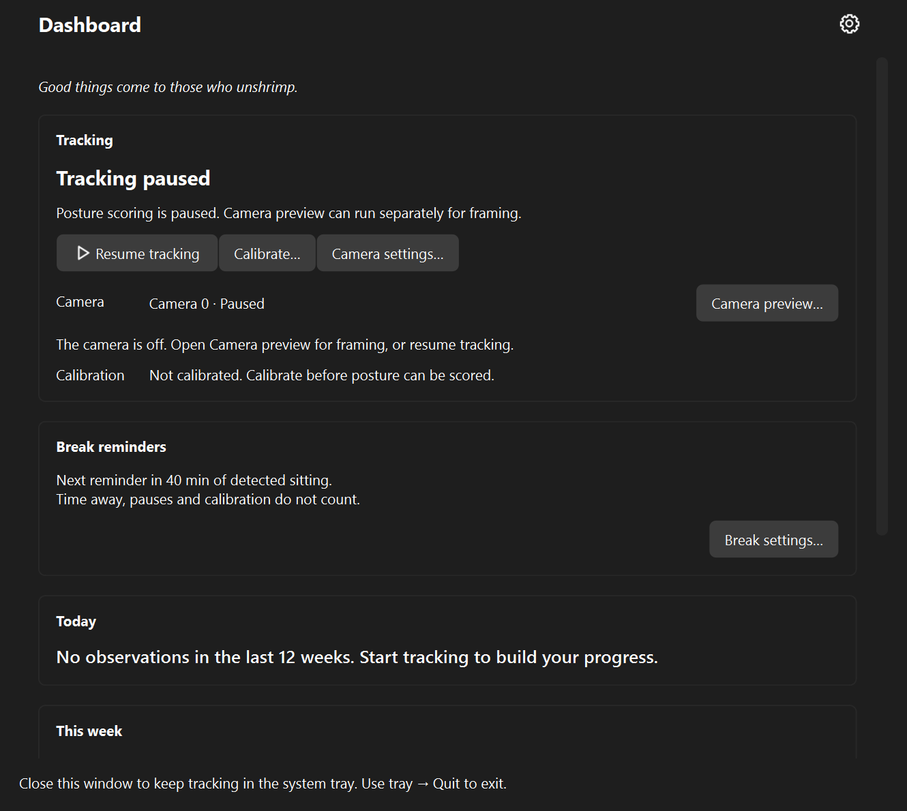
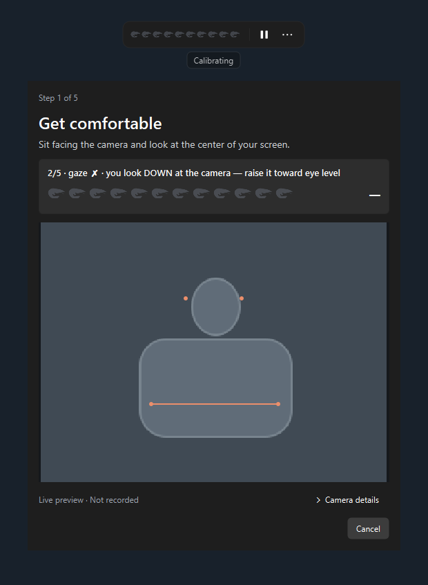
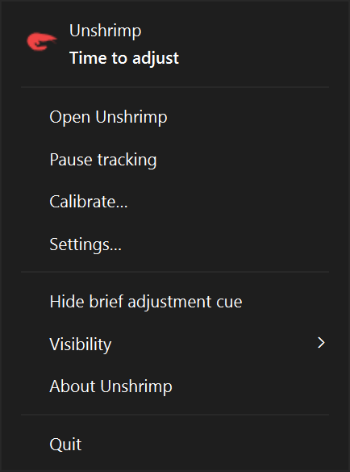
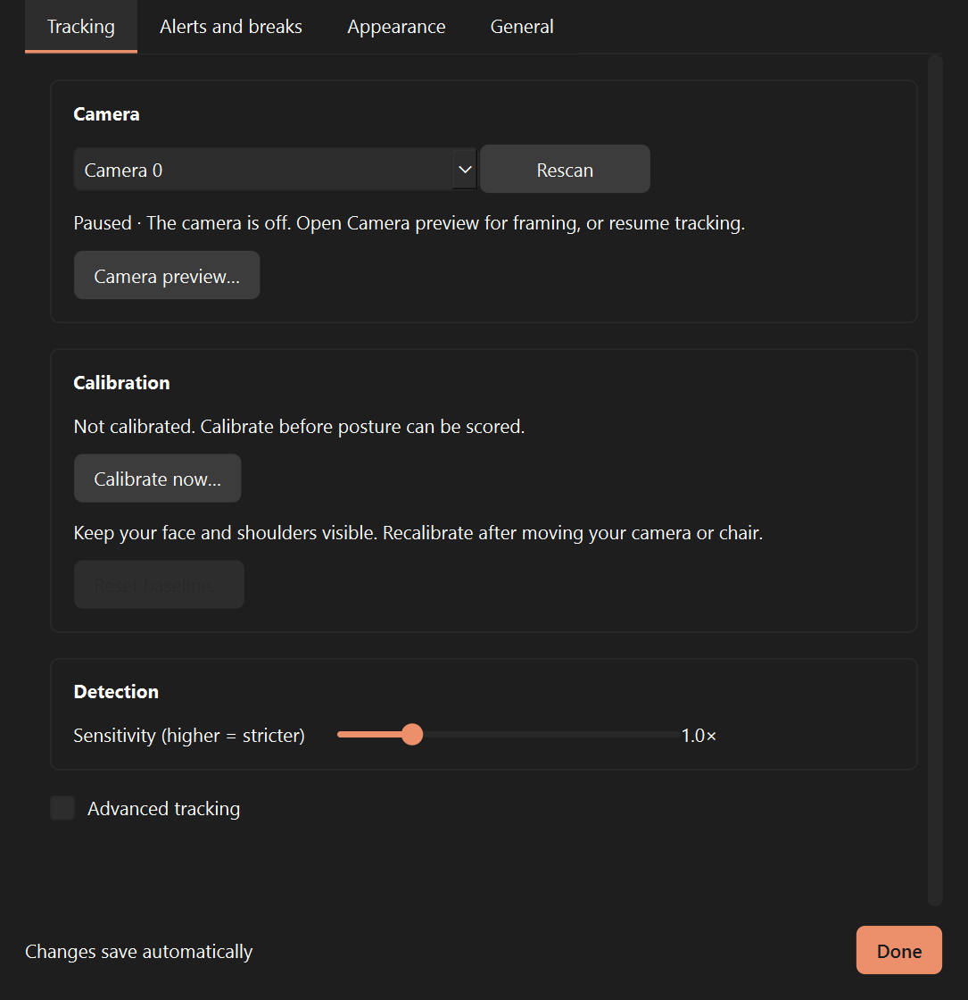
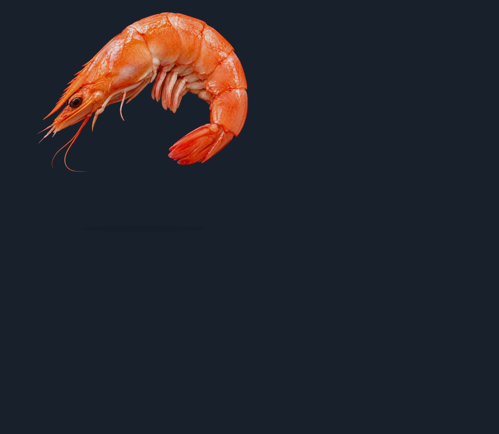

<p align="center"></p>

# Unshrimp

**Don't get shrimped.** A local, private posture guard for people with forward head posture and thoracic hunching. Unshrimp watches your webcam (fully on-device, 2 fps) — or slows to 1 fps when you're sitting fine, or speeds to 4 the moment you start sinking — compares your head/neck/shoulder geometry against **your own calibrated baseline**, and when you slouch… **a very large shrimp fades in at the bottom of your screen.** You are the shrimp. Uncurl.

> Nothing ever leaves your machine.

## What it looks like

| Dashboard | Guided calibration |
|---|---|
|  |  |

| Left-click menu | Settings (applies live) | The mascot, mid-slouch |
|---|---|---|
|  |  |  |

## Download

**Windows:** grab `unshrimp-win64.zip` from [**Releases**](https://github.com/msb090219/unshrimp/releases), unzip, and double-click **`unshrimp.exe`**. No Python or installs needed; the posture models ship inside the zip. After unzipping, right-click the exe → Properties → tick **Unblock** to stop the "downloaded from the internet" prompt on every launch (the binaries are unsigned).

**macOS:** not packaged right now — known first-run UI issues are being fixed. Brave souls can run from source (below).

First-run heads-ups: Windows may show SmartScreen (*More info* → *Run anyway*), and the OS will ask for **camera permission** — that's the whole app; grant it.

## How to use

1. **Calibrate** (main window or tray menu → *Calibrate…*) — a guided flow of about a minute in its own window, with a live **camera preview** and prominent pose instructions. Normal posture tracking is suspended during calibration.
   - **Setup check** — Unshrimp checks camera level, height, framing, and lighting. Setup details are available if needed. A blue shrimp wave marks preparation; colored shrimp count down usable capture time. Tracking loss pauses collection. Successful setup finishes with **Start tracking**; Later leaves tracking paused.
   - **Sit tall** (~10 s) → **Sit normal** (~8 s, becomes your scoring anchor) → **Hunch** (~6 s, defines where "red" is, per signal, for your body) → **Verify** (~12 s, Unshrimp proves your normal scores green before trusting itself).
2. **Live**: ten shrimp in the floating meter light up from green through amber to red as posture deviation increases. Unused shrimp remain gray. The meter stays bar-only during ordinary tracking; a brief adjustment cue fades after a sustained alert, while camera and calibration problems remain labelled. Pause/Resume and More sit on the right; More → Open Unshrimp opens the main window. More → Hide brief adjustment cue suppresses the temporary caption. The tray shrimp also changes color. **A large translucent shrimp rises from the bottom of the screen as you sink** — faint while drifting and more visible when hunched. It fades away as you return to range. Right-click the HUD or click the tray for controls. Appearance settings include Reduce motion.
3. **Nudges**: sustained hunching (45 s default) → toast, politely re-nagged until you recover.
4. **Life happens**: leave the desk and scoring pauses. Pausing tracking releases the camera when no preview or calibration is using it. You can explicitly open **Camera preview** while paused: it shows framing without posture inference, history, or sitting-time accumulation. Close that preview to release the camera. Recalibrate whenever your setup changes.
5. **Break reminders** after 40 min of detected sitting (configurable): editable stretch suggestions and a compact prompt directly beneath the meter (or above it near the screen edge). Set the break length from 1 to 30 minutes (default 2), choose Later in 5 or 10 minutes, or skip the reminder until the next full interval. Starting a break begins the chosen countdown with an End break action; sitting time and posture alerts pause until it finishes. Camera tracking continues. Time away, pauses, calibration, sleep, and camera outages do not count toward reminders. Reminder progress starts fresh when the app restarts.
6. **Dashboard**: the main window combines tracking, breaks, today's monitored time, a weekly posture mix, and a selectable 12-week activity heatmap. The short shrimp-themed line above Tracking changes each day. Settings contains preferences, with direct shortcuts to camera and break options.

In **Settings → Appearance**, preview the shrimp's size, transparency, motion,
display, and position without using the camera. The posture meter has Small,
Medium, and Large sizes, compact mode, and a position reset. Motion controls live
with the floating shrimp; choose **All displays** for one shrimp per connected
screen while keeping a single meter. Changes save automatically; **Done** closes
Settings. Slider changes apply on release, and failed saves restore the previous
setting with an error. **Alerts and breaks** keeps the break options and suggestion editor visible alongside an isolated reminder preview, **Test sound**,
and **Send test notification**. General provides About and the local data folder.
Reset baseline still requires confirmation.

## Privacy

- **No cloud. No accounts. No telemetry.**
- All pose estimation runs on-device via MediaPipe.
- **No frames, images, or video are ever written to disk** — only anonymous landmark coordinates in memory.
- Posture history lives in `%APPDATA%\Unshrimp` (a small SQLite file), outside this repo, and is never uploaded anywhere.

## Repository layout

Outstanding fixes and verification tasks live in the [work list](docs/TODO.md).

| Path | Purpose |
|---|---|
| `unshrimp/` | Desktop app: UI, posture logic, camera processing, and storage |
| `docs/index.html` | Landing page content; kept here for GitHub Pages compatibility |
| `docs/styles.css`, `docs/script.js` | Landing page styling and interactions |
| `docs/assets/` | Website copies of brand images, needed for standalone hosting |
| `docs/shots/` | App screenshots shared by the landing page and this README |
| `docs/ASSETS.md` | Brand asset specifications |
| `assets/` | Desktop app art, with original artwork in `brand/src/` |
| `tools/` | Build, artwork, screenshot, and camera diagnostic scripts |
| `tests/` | Automated app tests |
| `models/` | Downloaded posture models (not committed) |
| `.github/workflows/` | CI tests and release packaging |

Run commands from the repository root. `main.py` starts the app; `config.py`,
`fetch_models.py`, and `unshrimp.spec` support the app and release builds.

Preview the landing page with `python -m http.server 8000 --directory docs`,
then open http://localhost:8000. No frontend build step is needed.
Website asset paths must stay within `docs/` for standalone hosting; update
both image copies when changing shared brand art.

## Dev setup

Requires Python 3.10+. Windows is the primary platform; macOS works from source.

```bash
python -m venv .venv
.venv\Scripts\pip install -r requirements-dev.txt   # macOS/Linux: .venv/bin/pip
.venv\Scripts\pip install -e .                      # makes `unshrimp` importable for tests
.venv\Scripts\python fetch_models.py                # ~16 MB of MediaPipe models, one time
.venv\Scripts\python main.py                        # the app; or tools/vision_demo.py for a console demo
.venv\Scripts\python -m pytest -q                  # full regression suite
```

**macOS from source:** same steps; first camera open triggers the *"Terminal would like to access the camera"* prompt — Allow. Chime falls back to the system beep; the start-with-OS setting is hidden (add to Login Items manually).

**Troubleshooting:** the HUD bar has a right-click menu with everything the tray menu has. If something misbehaves, the run log at `%APPDATA%\Unshrimp\unshrimp.log` (Windows) or `~/Library/Application Support/Unshrimp/unshrimp.log` (macOS) is the file to attach to a bug report.

## How it works

Three scale-invariant signals, normalized by your inter-shoulder width:

| Signal | Catches |
|---|---|
| `head_pitch` | chin dropping toward the screen |
| `head_sink` | ears sinking toward shoulders as you collapse |
| `lean_in` | face-to-shoulder ratio climbing as you poke toward the monitor |

Calibration anchors scoring at your measured *normal* posture with the hunch sample setting the red distance (see `unshrimp/core/calibration.py`). Rolling-median smoothing and a head-turn gate keep normal movement from crying wolf; the verify phase auto-tunes until your normal reads green.

## Designing for Unshrimp

All built-in art is drawn in code, but **designed art wins**: drop PNGs into `assets/brand/` per [brand asset guide](docs/ASSETS.md) and the app picks them up — no code, no rebuild.

## Disclaimer

Unshrimp is a habit nudge, not a medical device. If you have neck/thoracic issues, pair it with proper physiotherapy.

## License

[MIT](LICENSE)

Opening Unshrimp shows its main window, or brings the existing window forward. Closing that window keeps tracking in the tray; choose Quit in the tray to exit. Settings → General → Start Unshrimp at login launches quietly with the main window hidden after setup. Manual pause is remembered across restarts. The --background command-line flag uses the same quiet startup behavior.
