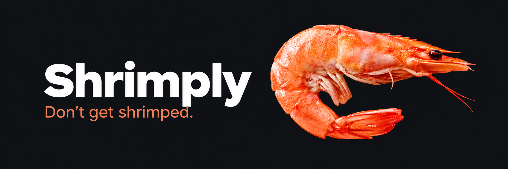
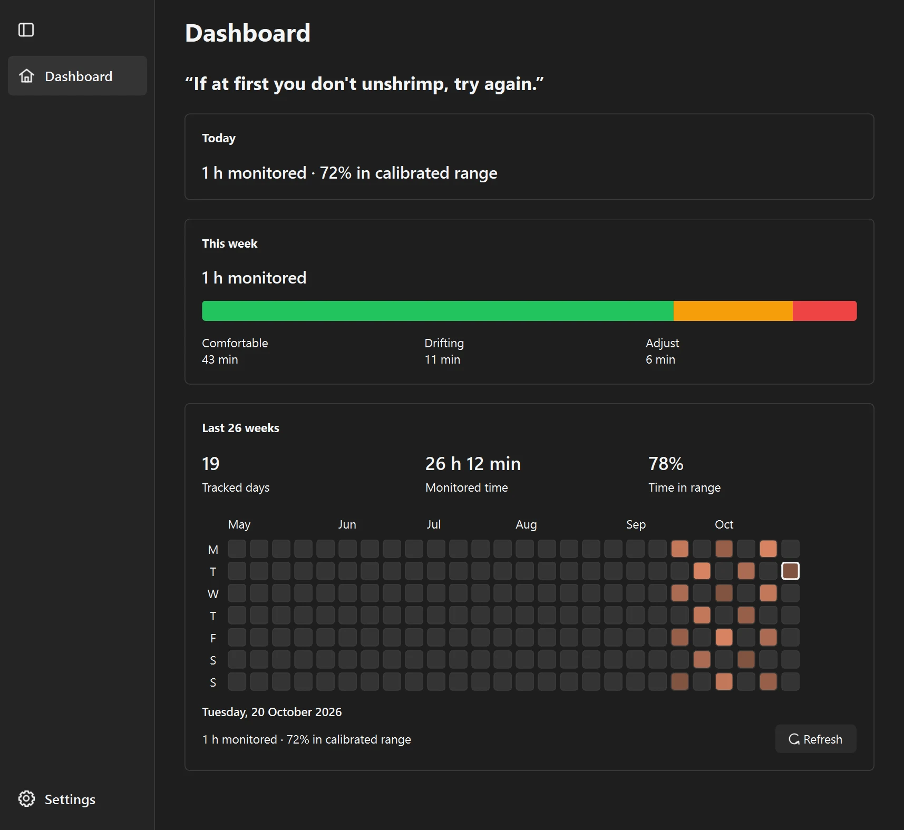
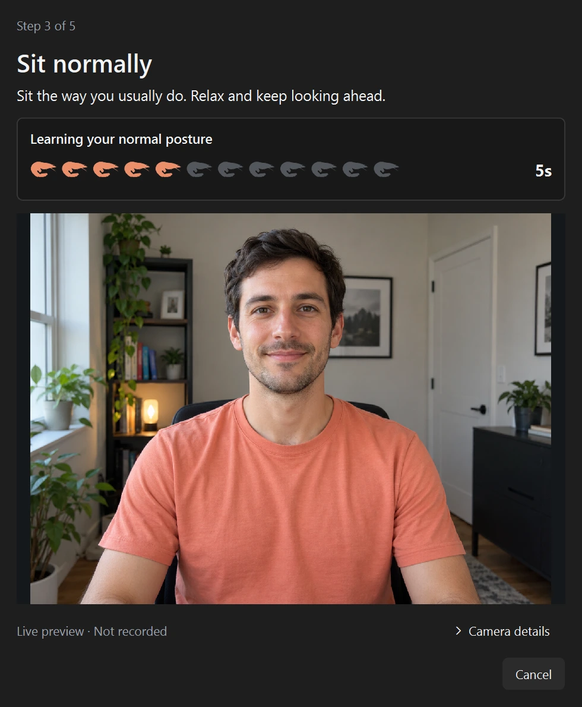
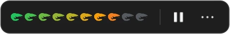
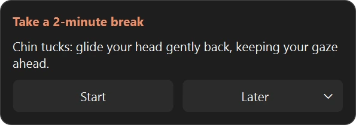
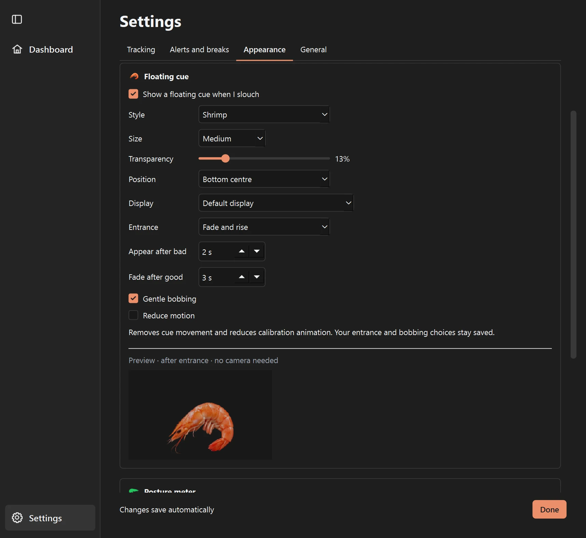

<p align="center"></p>

# Shrimply

**A gentle posture and break reminder for Windows.** Shrimply learns your usual sitting position with your webcam, then nudges you when you drift and when it is time to move. Camera processing stays on your device.

## Get Shrimply

Previously called Unshrimp. Existing settings, calibration and history carry
forward automatically; quit the old app before opening Shrimply for the first time.

**Windows:** Download `shrimply-win64.zip` from the [latest release](https://github.com/msb090219/shrimply/releases), extract it, and run `shrimply.exe`. The app and posture models are included; Python is not needed. Windows may show a SmartScreen warning because the app is unsigned. Allow camera access when prompted.

Shrimply opens its Dashboard on a normal launch. Closing the window keeps tracking in the system tray; choose **Quit** from the shrimp tray icon to exit.

<p align="center"></p>

<p align="center"><em>Dashboard shown with example history.</em></p>

## Set up your posture

Choose **Calibrate** from the Dashboard or tray menu. The guide checks camera framing, then asks you to sit tall, sit normally, and hunch briefly. Your normal pose anchors scoring; the hunch shows how far you can drift. Recalibrate after moving your chair or camera.

<p align="center"></p>

## See when you drift

The floating meter fills from green to red as posture drifts. If poor posture continues, you can show a shrimp or a discreet text cue. Pause or resume from the meter or tray; Camera preview works even while tracking is paused.

<p align="center"></p>

## Make room for a break

After a configurable amount of detected sitting, Shrimply suggests a stretch or short walk. Start a timed break, choose **Later**, or skip the reminder. Time away, pauses, and calibration do not count toward sitting time.

<p align="center"></p>

## See progress and make it yours

The Dashboard shows today's monitored time, a weekly posture mix, and an activity calendar covering up to 26 weeks. Open **Settings** from the sidebar to change camera, alerts, breaks, theme, and floating feedback. Changes save automatically.

<p align="center"></p>

## Privacy

Shrimply runs pose detection locally, does not save camera frames, and has no account or cloud sync. Posture history is stored on your computer in `%APPDATA%\Shrimply`. The bundled MediaPipe Tasks SDK sends API performance and usage metrics to Google; [Google says camera input stays on your device](https://github.com/google-ai-edge/mediapipe#privacy-notice). Shrimply is a habit aid, not a medical device.

## Run from source

Requires Python 3.10+. Windows is the primary supported platform.

```powershell
python -m venv .venv
.venv\Scripts\python -m pip install -r requirements-dev.txt
.venv\Scripts\python -m pip install -e .
.venv\Scripts\python fetch_models.py
.venv\Scripts\python main.py
.venv\Scripts\python -m pytest -q
```

For known issues and planned work, see the [work list](docs/TODO.md). If something goes wrong, attach `%APPDATA%\Shrimply\shrimply.log` to a bug report. The landing page lives in [`docs/`](docs/), and artwork guidance is in the [brand asset guide](docs/ASSETS.md).

## License

[MIT](LICENSE)
