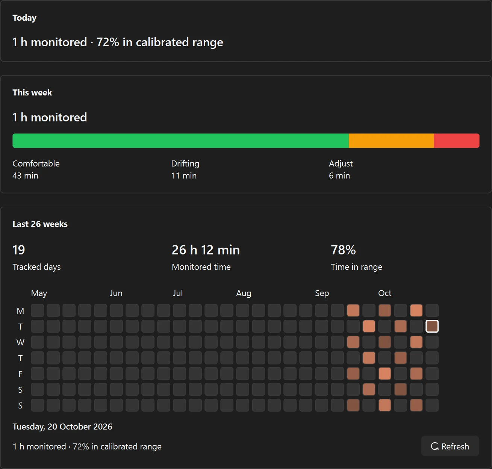

<p align="center"></p>

# Unshrimp

**A gentle posture reminder for your desktop.** Unshrimp uses your webcam to notice when you drift from your own calibrated posture, then gives you a quiet nudge to readjust. It also reminds you to take breaks. Camera processing stays on your device.

## Get Unshrimp

**Windows:** Download `unshrimp-win64.zip` from the [latest release](https://github.com/msb090219/unshrimp/releases), extract it, and run `unshrimp.exe`. The app and posture models are included; Python is not needed. Windows may show a SmartScreen warning because the app is unsigned. Allow camera access when prompted.

Unshrimp opens its Dashboard when launched normally. Closing the window leaves it running in the system tray; choose **Quit** from the shrimp tray icon to exit.

## Set up your posture

Choose **Calibrate** from the Dashboard or tray menu. The guided flow checks your camera view, then asks you to sit tall, sit normally, and hunch briefly. Your normal pose is the starting point for scoring; the hunch helps Unshrimp learn how far your posture can drift. A final check makes sure the result is usable. Recalibrate if you move your chair or camera.

<p align="center"></p>

## See when you drift

The floating meter fills from green to red as your posture moves away from its calibrated range. A brief cue appears after a sustained alert; a larger shrimp can also fade onto the screen. Pause or resume tracking from the meter or tray. You can open **Camera preview** to check framing even while tracking is paused.

<p align="center"></p>

## Make room for a break

After a configurable amount of detected sitting, Unshrimp suggests a stretch or a short walk. Start the break, choose **Later**, or skip that reminder. Time away from the desk, pauses, and calibration do not add to the sitting timer.

<p align="center"></p>

## Check your progress and preferences

The **Dashboard** brings together tracking, break timing, today's monitored time, a weekly posture summary, and a 12-week activity heatmap. **Settings** lets you adjust alerts, break timing, camera choice, and the floating shrimp's size, position, transparency, and motion. Changes save automatically.

<p align="center"></p>

## Privacy

Unshrimp runs pose detection locally. It has no account, cloud sync, or telemetry, and does not save camera frames. Posture history is stored on your computer in `%APPDATA%\Unshrimp`. Unshrimp is a habit aid, not a medical device.

## Run from source

Requires Python 3.10+. Windows is the primary supported platform.

```powershell
python -m venv .venv
.venv\Scripts\python -m pip install -r requirements-dev.txt
.venv\Scripts\python -m pip install -e .
.venv\Scripts\python fetch_models.py
.venv\Scripts\python main.py
.venv\Scripts\python -m pytest -q
```

For known issues and planned work, see the [work list](docs/TODO.md). If something goes wrong, attach `%APPDATA%\Unshrimp\unshrimp.log` to a bug report. The landing page lives in [`docs/`](docs/), and artwork guidance is in the [brand asset guide](docs/ASSETS.md).

## License

[MIT](LICENSE)
