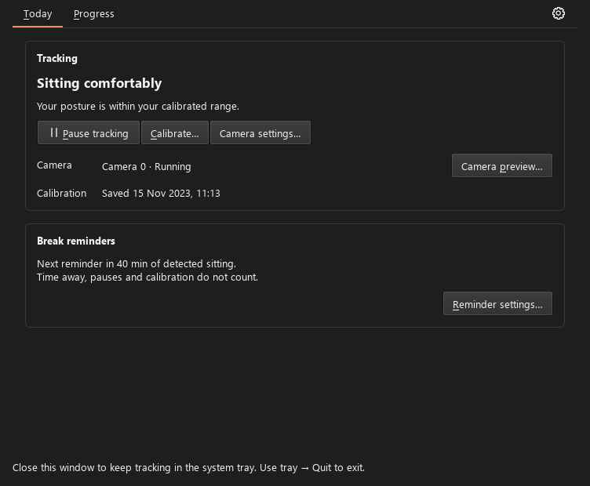
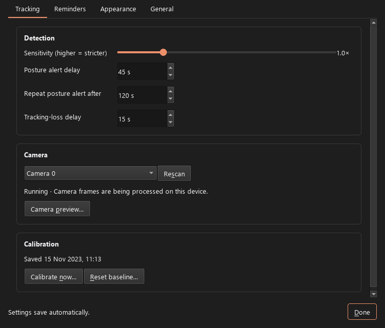
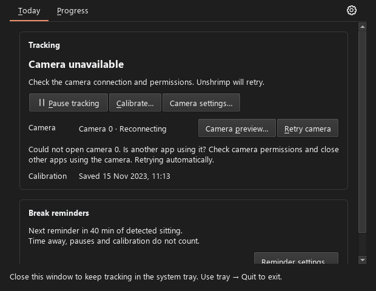
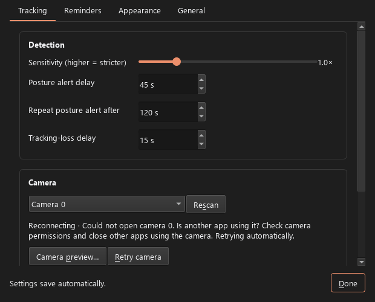
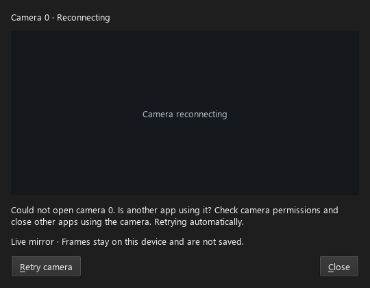
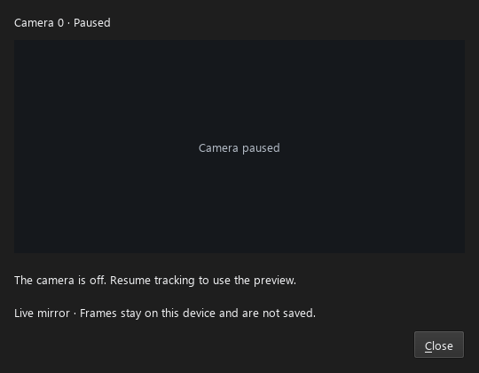
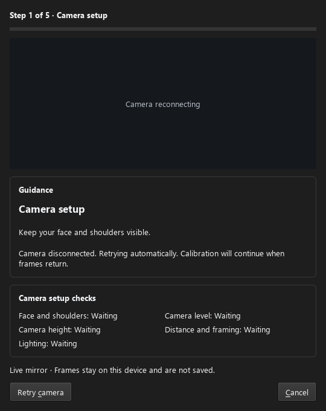

# Camera and calibration status

Main and Settings now share the camera lifecycle and calibration descriptions.
The camera is reported as running only after inference processes a frame, not
simply because the worker thread exists. Opening, reconnecting, stopping, paused,
and off states have their own descriptions. Errors include a Retry action while
automatic recovery continues. A saved baseline's date appears in both windows.

Camera preview is available from Main and Settings without starting calibration.
It follows the existing pause, idle, and sleep policy. Opening it while paused
does not start capture. Closing it stops the extra preview stream and discards
the displayed image. Replacing the worker reconnects the mirror, and queued
frames from an older worker are ignored.

Camera loss during calibration clears the frozen mirror, clears current setup
checks, and offers Retry camera alongside Cancel. Successful frames restore the
mirror without cancelling calibration. Resetting a saved baseline preserves a
paused session.

## Captures

Actual Qt widgets rendered offscreen with synthetic camera status, a dark test
palette, and Segoe UI. No webcam frames were captured or saved. Smaller windows
scroll vertically; the error text and actions fit without horizontal scrolling.

## Verification limits

Automated checks cover worker failure/recovery, shared lifecycle labels, saved
baseline descriptions, preview reuse and pause preservation, cleanup, late
frames, and Retry routing. Physical disconnect/reconnect, permission errors,
real Windows scaling, and the packaged live-camera flow still need hardware
verification. Devices retain their camera numbers; friendly hardware names
remain outstanding.
