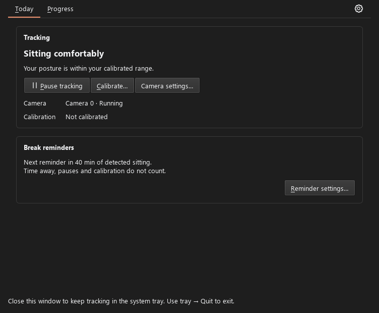
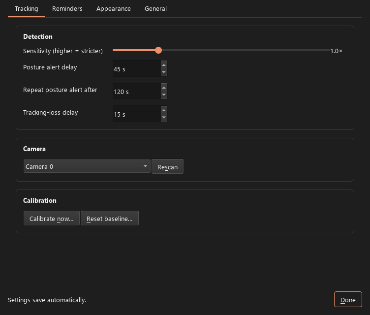
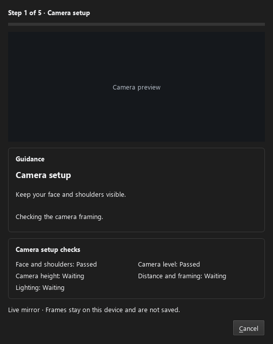
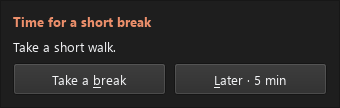
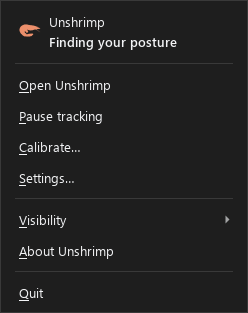
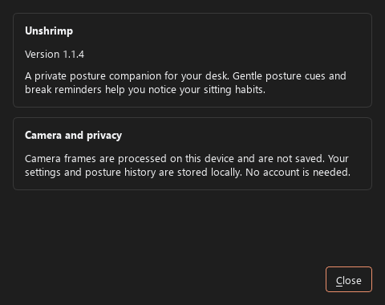

# Interaction feedback review — 17 October 2026

## Captured surfaces

1. **Main window** — clear status, primary tracking actions, and a separate reminder action. The settings cog, buttons, tabs, and other action controls had no hand-pointer feedback. Pointer feedback is now applied consistently.
2. **Settings** — the page groups settings by task and labels its controls. Tabs, buttons, toggles, selectors, sliders, and spin boxes now use a hand pointer while enabled; disabled controls revert to an arrow. Button hover and pressed states are explicit.
3. **Camera setup** — step, guidance, setup checks, privacy note, and cancel action are visible together. Action buttons now share the same pointer behavior. The capture uses a placeholder camera view, so it does not verify live framing.
4. **Posture indicator** — the bar remains draggable and its three controls expose accessible names and tooltips. The controls previously forced an arrow cursor; they now use the hand pointer while the bar and drag grip retain the move cursor.
5. **Break prompt** — the two actions explain their behavior through tooltips and now use the same pointer feedback.
6. **Tray menu** — actions have clear labels and the menu highlights its selected row. It keeps the native arrow cursor, matching normal Windows menu behavior.
7. **About** — the privacy statement is readable and the Close action shares the common pointer behavior.

The shared behavior is installed once at application level, so it also covers controls created later, including the modeless suggestion editor. Disabled controls use the normal arrow cursor. Keyboard focus, access keys, accessible names, and tooltips remain in place.

## Screenshots

## Limits

These are real Qt widget captures rendered offscreen with a dark palette and Segoe UI. They verify layout and copy, but cannot show the moving pointer or reproduce Windows title-bar placement. Cursor behavior is instead covered by Qt tests. A live keyboard-only and screen-reader pass remains outstanding.
