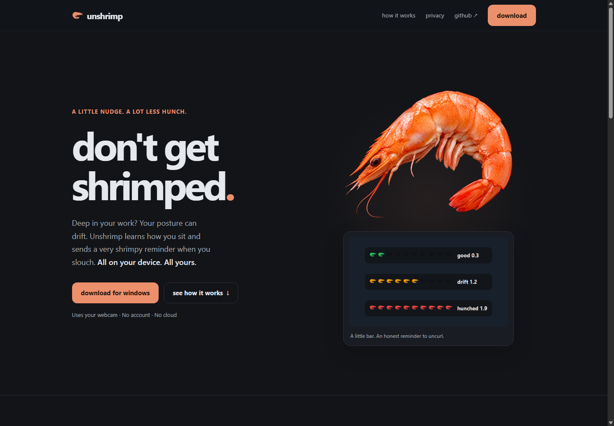
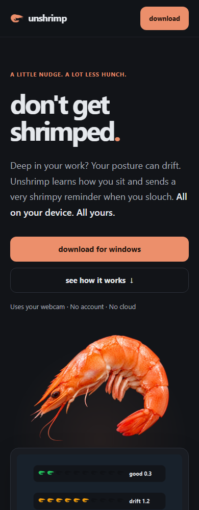
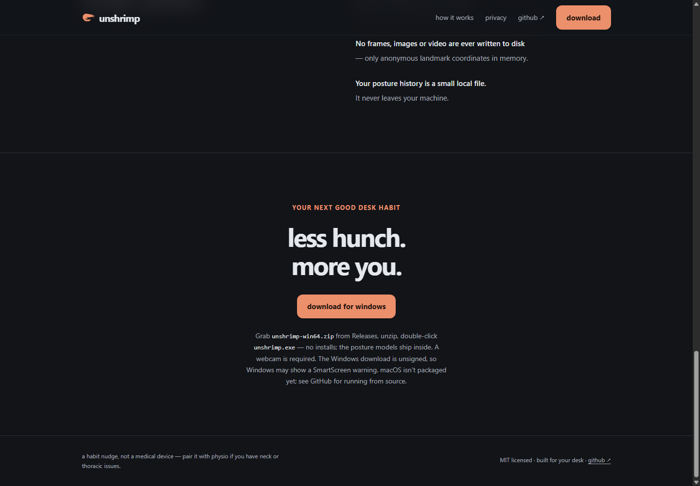

# Landing page refinement

16 October 2026. Applied `apple-design` and `emil-design-eng` while preserving
Unshrimp's dark/coral palette, real shrimp artwork, and playful language.

| Before | After | Why |
|---|---|---|
| Oversized artwork cropped at the hero edge | Two-column hero with contained art and the posture-bar screenshot | Show the product and character together without competing with the copy |
| Mobile hero touched the viewport edge | Shared responsive gutters and stacked actions | Keep text readable and controls comfortably separated |
| Header button inherited gray link text | Dark text on coral with explicit button styling | Make the primary action legible |
| Looping bubbles and 700 ms reveals; content hidden until JS runs | No decorative loops; optional 240 ms entrance animations; content visible by default | Keep motion purposeful and loading resilient |
| Dense technical explanations | Shorter benefits, personal setup explanation, and clearer download expectations | Explain the value before implementation details |

Additional changes: skip link, keyboard focus styling, touch-friendly action sizes,
reduced-motion/transparency and increased-contrast styles, lazy loading for
below-the-fold images, and clearer Windows/unsigned-download information.

## Checked

- Headless Chrome at exact 320, 390, 768, and 1440 px viewport widths: no
  horizontal document overflow, intact hero gutters, and correct mobile navigation.
- All page images loaded, local asset references exist, and internal anchors resolve.
- The header download button uses dark text on coral.
- Reduced-motion emulation: no active animations.
- JavaScript disabled: reveal-marked content remains visible.
- Assert-based script checks: intersecting/nonintersecting entries, reduced motion
  at startup and before reveal, and unavailable IntersectionObserver.
- JavaScript syntax and Git whitespace checks passed.

## Inspected captures

Desktop hero:

Mobile hero:

Download section:

The screenshots above replace early narrow-window captures that did not establish
the correct mobile viewport. Browser connector access disappeared during a server
restart, so final verification used local headless Chrome through its debugging
protocol. No browser automation dependency was installed.

## Remaining checks

Physical-phone Safari/Chrome, complete keyboard/screen-reader interaction, and
the live GitHub release/download flow remain unverified. Existing app screenshots
were reused; refresh them when the desktop UI redesign ships. No deployment,
desktop app changes, new frontend framework, or dependency installation was made.
