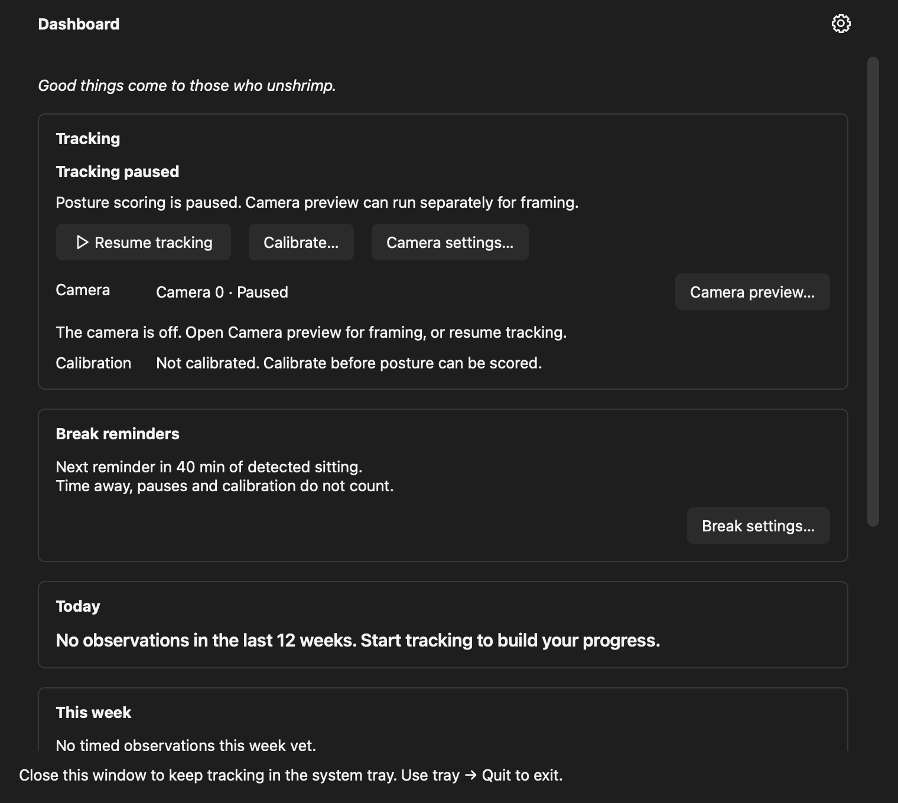
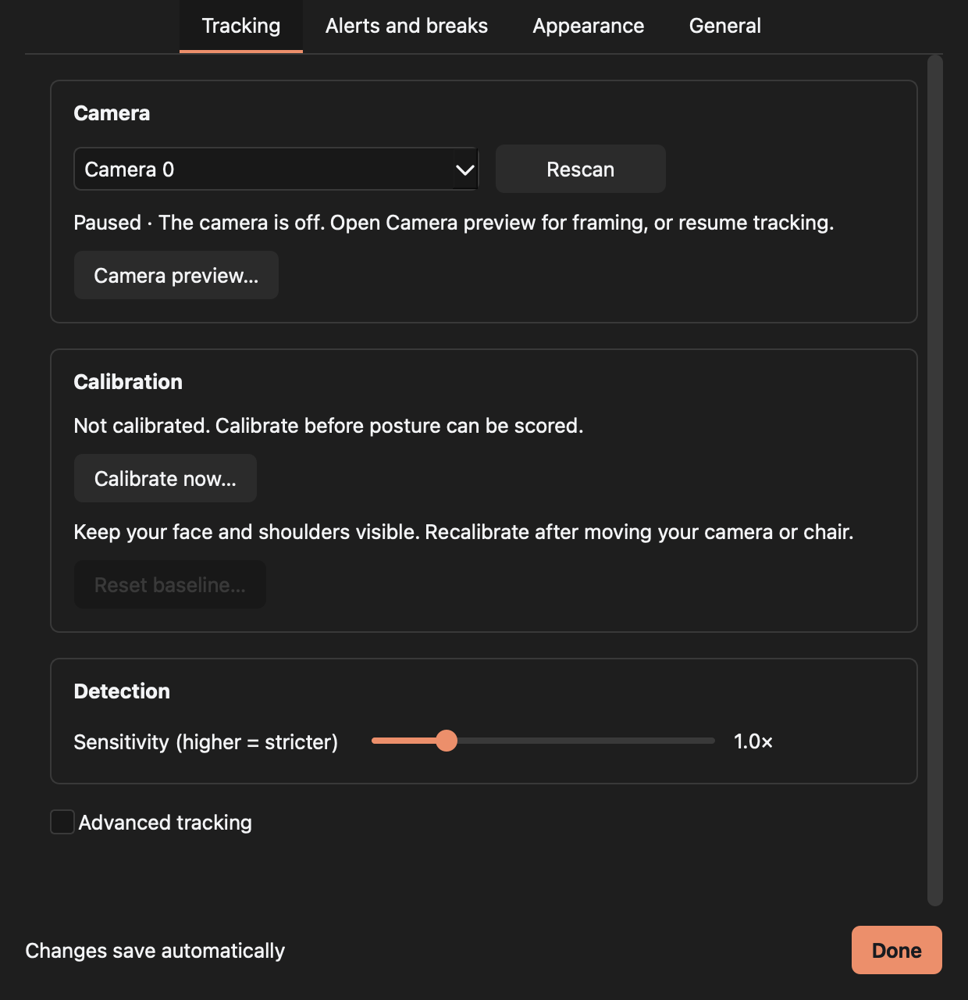
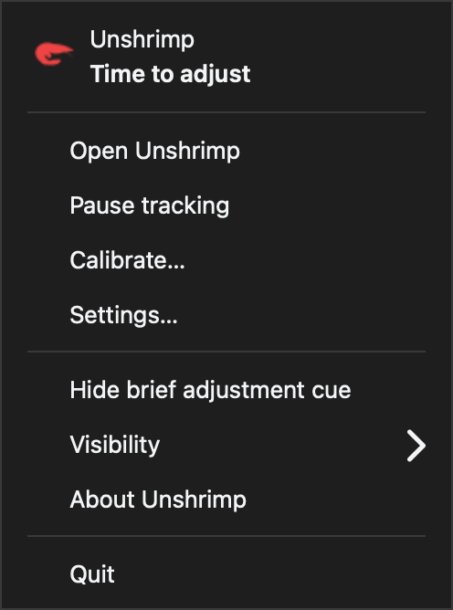

# First macOS pass — 18 October 2026

Captured on this Intel Mac running macOS 15.7.9, using the production Qt widgets
with the macOS style and system font. These captures use an empty, paused sample
state; no webcam frames or personal posture history were saved. They show widget
content, not the native title bar or global application menu.

## 1. Dashboard — functional, needs a more compact layout

Tracking state, camera state, and calibration are clearly labelled. The large
stacked cards and repeated explanations push progress below the fold. The footer
uses Windows-oriented “system tray” language. The next layout pass should put
tracking controls in a compact toolbar and give progress its own clear place.
Keep the existing status explanations available without repeating them throughout
the main view.

This pass adds native application menus, Settings (Command-comma), Quit
(Command-Q), Close Window (Command-W), and Minimize (Command-M). Closing the
dashboard leaves tracking running. The footer now describes the menu bar.

## 2. Settings — usable, navigation needs attention

The four named categories and automatic-save status are useful. Large bordered
sections make the page long, and the camera controls mix configuration with
status explanations. Prefer a Mac settings sidebar with compact labelled rows
and help text below each group. Preserve accessible names and visible focus when
restyling the controls. The existing default Qt font is already the Mac system
font; a font replacement alone would not address the layout.

Source inspection also found Windows-only login startup controls and DirectShow
camera enumeration in Settings. Those need Mac implementations in the next pass;
the current camera tracking path already selects AVFoundation correctly.

## 3. Menu bar controls — useful, simplify presentation

The explicit status label and pause/open actions make the app usable without the
dashboard. The current custom menu is dense and includes an advanced adjustment
cue toggle above the visibility submenu. Prioritize Open, Pause/Resume, Settings,
and Quit, and move display preferences into Settings. Retain a text status so
colour is never the only signal. Inspect the actual native popup before replacing
it: a QWidget capture does not prove how macOS renders its native menu.

## Power and idle changes

- Core Graphics now supplies real system idle time on macOS; the existing
  five-minute tracking shutdown policy can run.
- Cocoa workspace notifications drive system sleep, display sleep, and user
  session suspension through the existing controller callbacks.
- Screen lock/unlock notifications provide an additional suspension reason. These
  distributed notification names are macOS implementation conventions rather than
  a documented public lock API, so actual lock behaviour must be checked on target
  macOS releases.
- Overlapping reasons are tracked independently. A display wake does not restart
  tracking while a lock or another suspension condition remains.
- Observer cleanup removes registrations and ignores queued callbacks.

The native integration test runs in a subprocess because Cocoa owns global
application state, while the wider Qt suite creates multiple test applications.
The complete suite passed: **462 passed, 2 skipped** (Windows message delivery
and Windows login startup). Existing deprecation warnings remain.

An additional local check exercised the real webcam, controller, and native Qt
event loop, using isolated temporary settings and history. It verified capture
shutdown, restart, overlapping lock/wake, idle/input recovery, and preservation
of manual pause. Notifications and idle thresholds were injected only into that
process; the Mac itself was not put to sleep or locked. Counts and measurements
are in [power-validation.json](power-validation.json).

Over two five-second samples, process CPU usage was about **10% of one core while
tracking** and **0.11% while suspended**. This is a short process CPU comparison,
not a battery-life estimate. The first ad hoc probe used manual event pumping and
failed on camera restart; rerunning through a native Qt event loop passed without
a camera-code change.

## Remaining device checks

1. Close and reopen the laptop lid; verify tracking recovers without recalibration.
2. Lock/unlock, sleep/wake, and switch user sessions. Verify the camera indicator
   turns off and no posture/sitting time is added while capture is stopped.
3. Repeat while manually paused and while a camera preview or calibration is open.
4. Measure tracking and paused use over a longer period on battery, including
   external displays and clamshell mode.

Screenshots do not establish VoiceOver behaviour, contrast compliance, keyboard
coverage, or physical sleep/wake reliability. Those remain explicit validation
steps before a Mac release.
