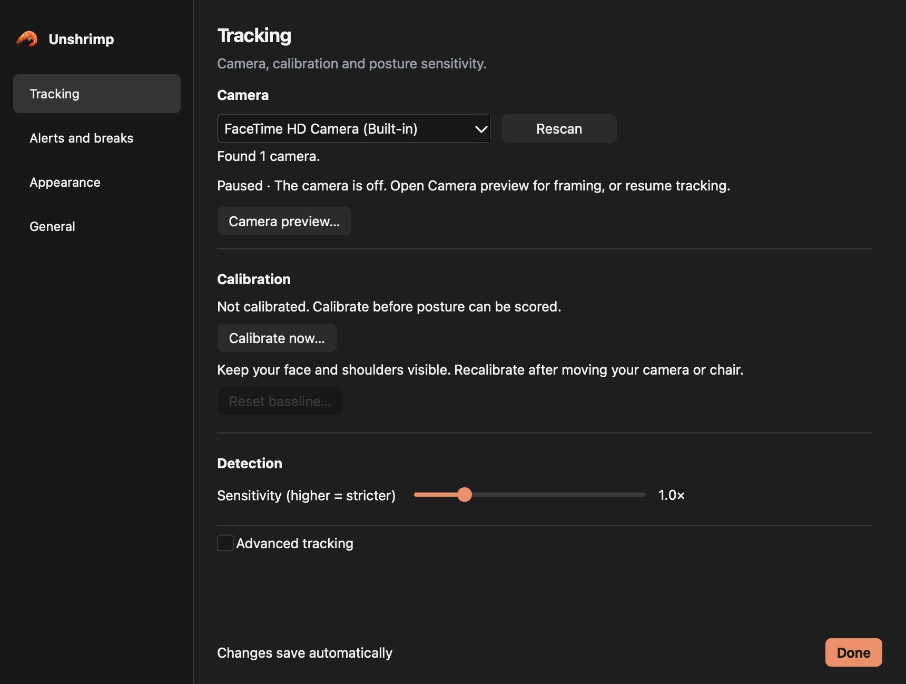
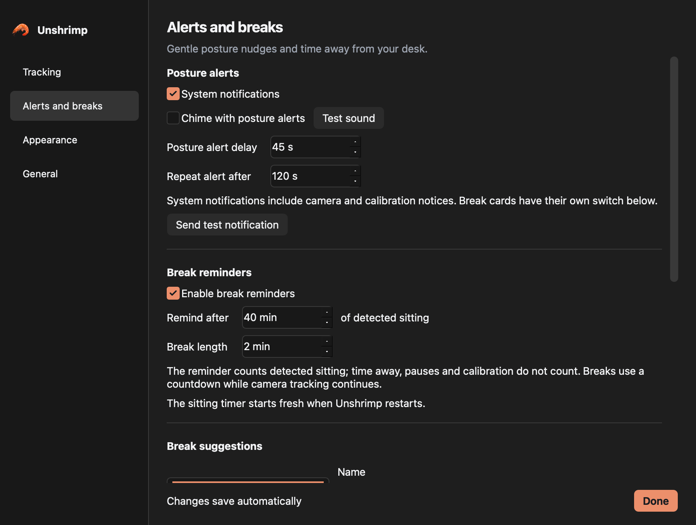
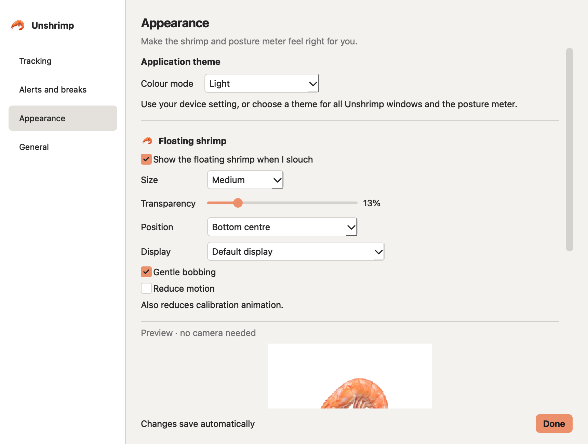
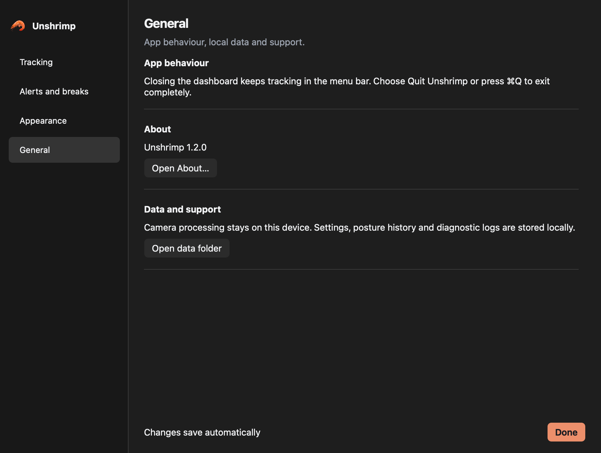

# Mac Settings — 18 October 2026

Settings now uses a Mac sidebar with the existing Tracking, Alerts and breaks,
Appearance, and General pages. Smaller section spacing and dividers replace the
boxed cards. The settings controls and automatic saving still use the existing
preferences logic.

## Tracking

At the default 860 × 650 logical window size, the standard tracking controls fit
without scrolling. The selected camera has an integer device ID independent of
its display name. Explicit Rescan lists AVFoundation cameras without opening any
capture devices, and follows OpenCV's unique-ID ordering. If a camera disappears
or scanning fails, the selection is retained and an inline result explains what
to do next.

## Alerts and breaks

Existing alert delays, notifications, break timing, suggestion editing, and
isolated previews remain available in the scrollable page. Test-notification
feedback now refers to macOS. The fixed footer keeps save feedback and Done in
reach while scrolling.

## Appearance

The four categories stay in place while switching themes or editing the shrimp
and meter. The screen uses the Mac system font and the existing shrimp accent.
Both themes, the lower preview controls, and the minimum 760 × 520 logical size
were captured and inspected. Long pages scroll vertically.

## General

Mac wording explains menu bar behaviour and Command-Q. The empty Startup group
is replaced with App behaviour; the Windows startup control is not shown on Mac.
About and the local data folder remain available.

## Checks

- Full test suite: **471 passed, 2 skipped**, with a clean exit.
- Tests cover saved preferences, rollback after a failed camera change, named
  device IDs, backend selection, scan failure/no-device states, deep links,
  sidebar arrows, Tab order, and category/close shortcuts.
- A separate native Cocoa check identified this Mac's FaceTime HD Camera,
  preserved the selection after Rescan, switched categories with Command-3, and
  closed Settings with Command-W. Results are in `native-check.json`.
- Opening Settings does not probe cameras. Rescan is an explicit user action.
- The pre-existing Qt test cleanup leak was fixed by disposing of two test-created
  progress widgets before application teardown.

Screenshots show the production widgets with an empty, paused sample state and
native camera enumeration. No webcam images or personal posture history were
saved. Widget captures exclude native window chrome. VoiceOver and multiple
physical cameras still need hands-on checks.
