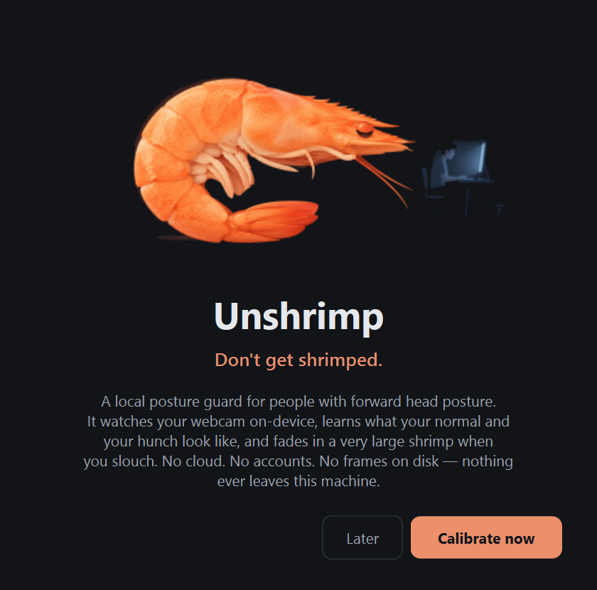
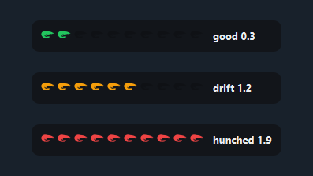
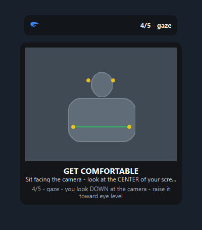
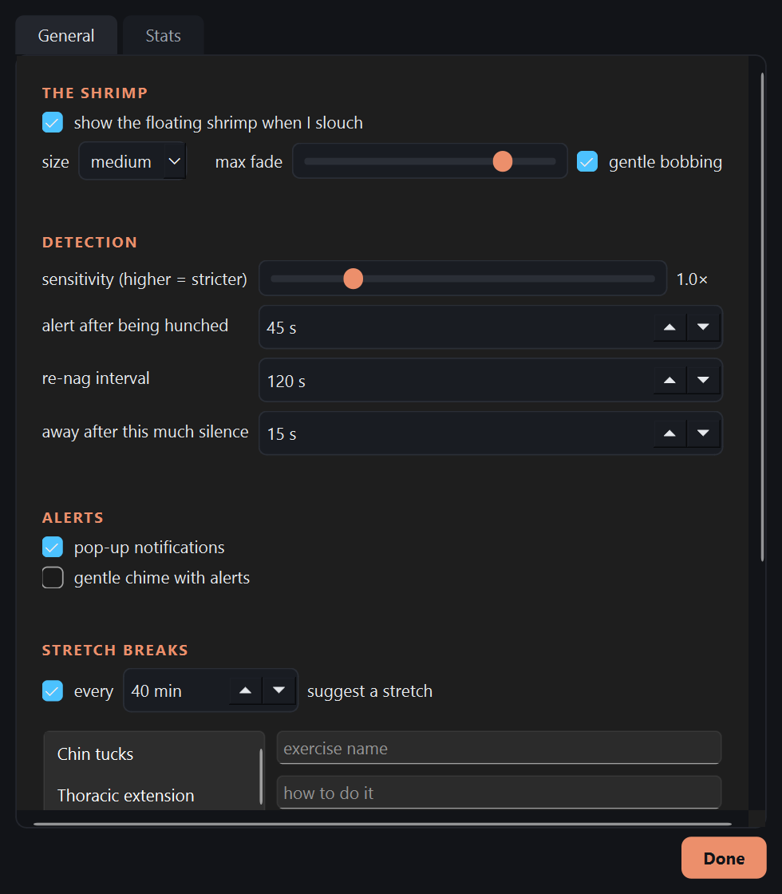
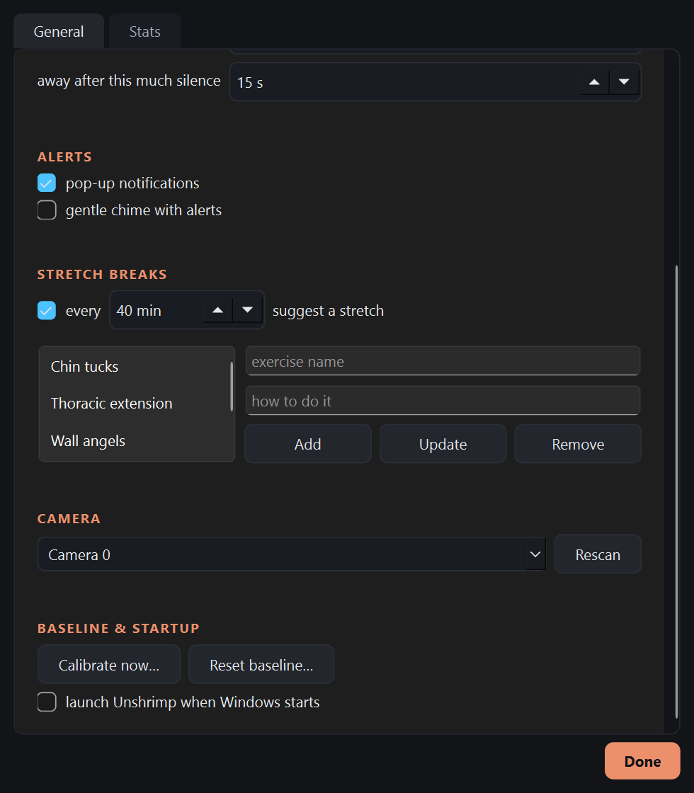
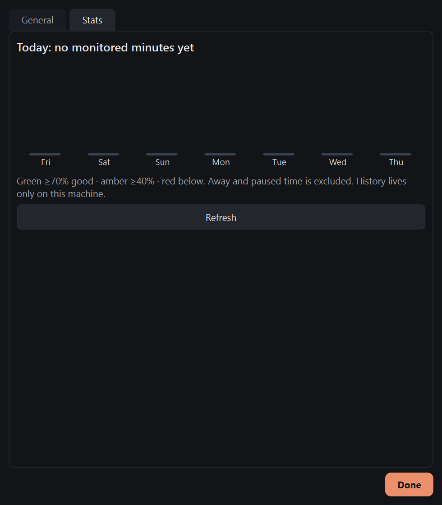
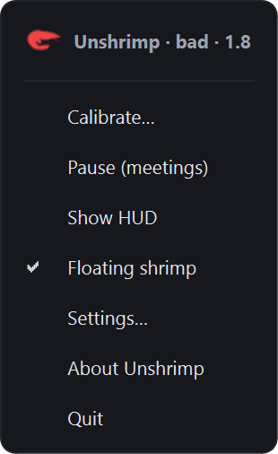
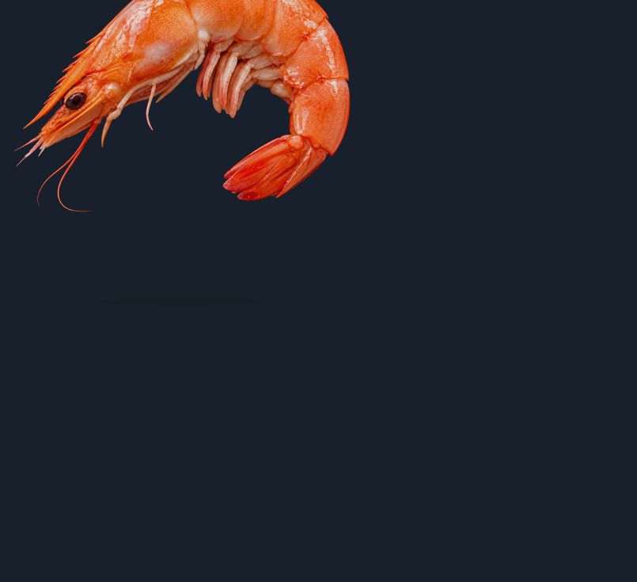

# Desktop UI review

15 October 2026. Scope: welcome, posture HUD, calibration preview, settings,
history, tray menu, and mascot. No application code changed.

## Recommendation

Keep the dark surfaces, coral accent, shrimp identity, and unobtrusive desktop
presence. Redesign the core experience around three connected surfaces:

1. A quiet, readable posture HUD with an obvious way to open controls.
2. One guided calibration panel containing the camera, instructions, progress,
   and recovery actions.
3. One coherent preferences window with task-based navigation.

The largest opportunity is clarity and confidence: users should understand what
is happening, what they should do, and whether the camera is running. Decorative
motion comes after those basics.

## Evidence and limitations

These are fresh renders of the current native Qt widgets, using Windows' native
renderer. They are not screenshots of an end-to-end live app session. The first
offscreen attempt had missing fonts and was rejected; the accepted files below
replace those captures.

Camera imagery is the existing synthetic test scene. Camera selection and log
storage were replaced with in-memory stubs to avoid opening cameras or changing
user settings/history. The history view uses seven empty days. HUD and tray
examples are supplied representative states; the screenshot utility includes
numeric HUD labels that the live controller does not normally show. The proposed
changes below distinguish those examples from actual controller behavior.

Different capture paths retain different image pixel densities; do not compare
their apparent physical sizes directly. Typography and layout still need checks
at real Windows display scaling settings. Focus traversal, assistive technology,
actual animation timing, window movement, and live camera transitions were not
tested. This is a visual and code-backed review, not a full interaction or
accessibility certification.

## Screens reviewed

### 1. Welcome — recognizable, but explains more than it demonstrates

The identity and primary action are clear. A large illustration and a dense
centered paragraph dominate the screen, while setup duration and the experience
after calibration are absent. Keep the personality, shorten the copy, explain
camera use and the roughly one-minute setup, and preview the posture feedback.

### 2. HUD — compact, but the meter's meaning needs work

The slim silhouette and state labels are useful. More filled shrimp means worse
posture, which can look like progress or a reward. The live controller uses plain
state labels; raw deviation numbers appear in the tray and screenshot examples.
Neither the fill direction nor the underlying score is explained.

Make a plain-language state the first thing users read. Keep a restrained
severity indicator, explicitly label its meaning when expanded, and keep raw
deviation in diagnostics. Do not invent a posture percentage from that score.
Offer one visible control for pause and preferences instead of relying on
right-click and state-dependent double-click behavior.

### 3. Camera/setup — highest-priority flow redesign

The video and instructions are separated, which keeps the image unobstructed.
However, the essential instruction is visibly elided. Progress lives in the HUD,
guidance lives below a separate floating camera window, and actions such as
Continue anyway are routed through the tray. The preview itself has no visible
cancel, retry, or camera-choice control.

Use one calibration panel: header with close/cancel, current step and remaining
time, camera area, a wrapping instruction, and a footer with appropriate actions.
Show setup checks as named pass/fail rows rather than only a count. Once all
checks pass, give a brief preparation cue before each capture starts. Pause
collection visibly if tracking is lost. Make Retry and any quality override
available in the panel, with the effect explained.

After verification, show what was learned, a brief feedback demonstration, and
a clear Start tracking action. A live video mirror alone does not teach users
how to respond to the shrimp.

### 4. Settings, top — functional but too much in one form

Coral section labels and a consistent Done action help. Mascot appearance,
detection, alerts, and exercise editing compete in one scrollable form. At the
captured size a horizontal scrollbar is visible. Long labels and crowded control
rows should reflow rather than require horizontal scrolling.

Use task-based pages: Tracking, Reminders, Appearance, and General. Tracking
contains camera and calibration; Reminders contains posture notifications and
stretch breaks; Appearance contains HUD/mascot controls; General contains startup
and application information. Progress can remain a separate destination.

Show common controls first and place technical timings in Advanced. Explain
that changes save automatically. Use natural labels such as Reminder interval,
Visibility, and Tracking sensitivity. Sensitivity needs understandable endpoints
and a way to restore its default; a multiplier alone is not explanatory.

### 5. Settings, bottom — camera and calibration are buried

Camera selection is below the exercise editor, while calibration and Windows
startup share a section despite being unrelated. Camera 0 is a machine index,
not a useful device identity. Calibration status/date are not shown.

Move camera and calibration into Tracking. Show device names where available,
a deliberate preview action, current camera state, and last calibration details.
Use clear nearby error/retry feedback. Put Reset calibration in a secondary
danger area, apart from the normal Recalibrate action. Keep exercise editing in
a dedicated subview so it does not overwhelm the basic reminder controls.

### 6. Progress — too little explanation or reward for returning

The empty state correctly distinguishes no monitoring from zero good posture,
but the screen leaves most of its area unused and offers only Refresh. Explain
when data will appear and offer the relevant next action. With data, emphasize
monitored duration and time in posture states, then a readable weekly view.

Do not market the current frame-weighted percentages as time-based progress;
T06 must be fixed first. Avoid health scores or improvement claims unsupported
by the measurements. Make data gaps and excluded away/paused time clear.

### 7. Tray menu — useful fallback, but not the main control surface

Keep the tray for quick pause/resume, opening preferences, calibration, and quit.
The header currently exposes terms such as bad and an unexplained deviation.
Use the same posture language as the HUD. State-dependent double-click behavior
is also hard to learn; choose one predictable action and expose controls visibly.

### 8. Mascot — distinctive, but needs composition and restraint

The photorealistic shrimp is memorable. In this rendered large state, it extends
beyond the fixed window bounds and is clipped. The artwork and the tiny flat HUD
icons also express the brand differently. That can be intentional, but it needs
shared composition, accent colors, and behavior.

Keep the large shrimp as the signature cue, fit every size/rise state inside its
window, and provide an in-settings preview. Make visibility and motion easy to
control. Use a quiet fade/rise for state changes; avoid continuously demanding
attention. Verify the appearance against actual light/dark desktop content.

## Prioritized design changes

| Priority | Before | After | Why |
|---|---|---|---|
| P1 | Ten-segment meter with implicit severity direction | Clear state, explicit severity meaning, expandable details and visible controls | Users can interpret and act on feedback immediately |
| P1 | Separate HUD, fixed camera box, tray-only recovery actions | One guided calibration panel with progress, wrapping guidance, and inline actions | Setup becomes understandable and recoverable |
| P1 | Long General form mixing unrelated tasks | Tracking, Reminders, Appearance, General; Progress separately | Controls are easier to find without scanning a long form |
| P1 | Generic Camera 0 and hidden camera lifecycle | Device identity, accurate camera status, deliberate preview and retry | Camera use becomes predictable and trustworthy |
| P2 | Mixed typography, tiny fixed text areas, horizontal scrolling | Shared typography/control tokens, wrapping layouts, accessible native controls | The UI feels coherent and survives display scaling |
| P2 | Appearance sliders without a preview; clipped large mascot | Live in-settings example, contained artwork, clear visibility/motion choices | Personalization becomes understandable |
| P2 | Intro paragraph followed immediately by calibration | Brief setup expectations, guided capture, explicit completion and feedback demo | Users learn the product before relying on it |
| P2 | Sparse history screen with manual refresh | Useful empty state, monitored time, understandable weekly history | Users can see the value of continued use |

## Accessibility and motion

The HUD and preview are custom-painted widgets. Their text and states need
accessible names/descriptions and keyboard-operable equivalents; painting a
label does not provide screen-reader semantics automatically. Instructions must
wrap instead of being clipped. Keep state names in addition to color.

Verify visible keyboard focus, tab order, contrast over real desktop content,
Windows text scaling, and 100%, 150%, and 200% display scaling. Test every setup
error state rather than only the successful capture.

Use brief transitions to explain opening/closing and posture-state changes,
retain immediate response for frequent controls, and respect reduced-motion
preferences. These choices follow the principle of purposeful, restrained motion
in [Emil Kowalski's design guidance](https://github.com/emilkowalski/skills/tree/main/skills/emil-design-eng).
That guidance informs recommendations, not measurements of current animations.

## Suggested delivery order

1. Resolve tracking/camera trust bugs T01–T05 alongside the UI work.
2. Design the HUD and unified calibration flow together.
3. Establish shared typography, spacing, focus, and control styles; apply them
   while restructuring settings.
4. Refine mascot composition, onboarding/completion, and progress after T06.

Implementation tasks are tracked as U01–U08 in [the work list](../../TODO.md).
